# E5–E6 ConvNeXt-Tiny validation evidence

Four completed single-seed runs on frozen five-grade splits. Each row uses its own best validation macro-F1 epoch, with lower raw categorical CE and then earlier epoch as tie-breakers. APTOS2019 has 366 validation images and DDR has 1,252.

[E5 protocol](../novelty_integrated/e5/README.md) · [E6 protocol](../novelty_integrated/e6/README.md) · [Audit and reproduction](#audit-and-reproduction) · [Figure index](#figure-index)

## Best validation checkpoints

| Dataset | Run | Epoch | Accuracy | Macro-F1 | Weighted-F1 | QWK | Grade MAE | Categorical CE | Correct | Wrong | High-confidence wrong |
| --- | --- | --- | --- | --- | --- | --- | --- | --- | --- | --- | --- |
| APTOS2019 | [E5](../results/APTOS2019/e5_integrated/validation_report.md) | 16 | 0.83060 | 0.70579 | 0.83308 | 0.89924 | 0.22131 | 0.58854 | 304 | 62 | 23 |
| APTOS2019 | [E6](../results/APTOS2019/e6_ldam_ordinal_adjacent/validation_report.md) | 15 | 0.78962 | 0.67920 | 0.79589 | 0.88038 | 0.27322 | 0.81660 | 289 | 77 | 0 |
| DDR | [E5](../results/DDR/e5_integrated/validation_report.md) | 18 | 0.82348 | 0.65320 | 0.81819 | 0.85716 | 0.26677 | 0.88551 | 1031 | 221 | 118 |
| DDR | [E6](../results/DDR/e6_ldam_ordinal_adjacent/validation_report.md) | 12 | 0.79792 | 0.66246 | 0.81229 | 0.84955 | 0.28355 | 0.92770 | 999 | 253 | 0 |


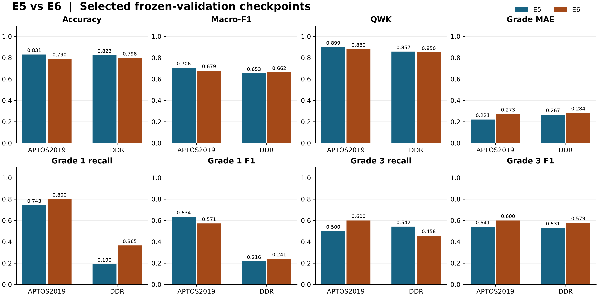

Paired bars summarize selected checkpoints on each dataset. Scores use their original units. [SVG for publication](figures/e5_e6_best_validation.svg).

### Absolute and relative changes

Absolute change is E6 minus E5 in metric units. Relative change divides this difference by E5. Lower Grade MAE and categorical CE are preferable. These estimates have no confidence intervals.

| Dataset | Metric | E6 − E5 | Relative to E5 |
| --- | --- | --- | --- |
| APTOS2019 | Accuracy | -0.040984 | -4.93% |
| APTOS2019 | Macro-F1 | -0.026587 | -3.77% |
| APTOS2019 | Weighted-F1 | -0.037190 | -4.46% |
| APTOS2019 | QWK | -0.018857 | -2.10% |
| APTOS2019 | Grade MAE | +0.051913 | +23.46% |
| APTOS2019 | Categorical CE | +0.228067 | +38.75% |
| DDR | Accuracy | -0.025559 | -3.10% |
| DDR | Macro-F1 | +0.009256 | +1.42% |
| DDR | Weighted-F1 | -0.005898 | -0.72% |
| DDR | QWK | -0.007609 | -0.89% |
| DDR | Grade MAE | +0.016773 | +6.29% |
| DDR | Categorical CE | +0.042194 | +4.76% |


### Grades 1 and 3

| Dataset | Grade | Run | Support | TP | FP | FN | Precision | Recall | F1 |
| --- | --- | --- | --- | --- | --- | --- | --- | --- | --- |
| APTOS2019 | 1 | E5 | 35 | 26 | 21 | 9 | 0.55319 | 0.74286 | 0.63415 |
| APTOS2019 | 1 | E6 | 35 | 28 | 35 | 7 | 0.44444 | 0.80000 | 0.57143 |
| APTOS2019 | 3 | E5 | 20 | 10 | 7 | 10 | 0.58824 | 0.50000 | 0.54054 |
| APTOS2019 | 3 | E6 | 20 | 12 | 8 | 8 | 0.60000 | 0.60000 | 0.60000 |
| DDR | 1 | E5 | 63 | 12 | 36 | 51 | 0.25000 | 0.19048 | 0.21622 |
| DDR | 1 | E6 | 63 | 23 | 105 | 40 | 0.17969 | 0.36508 | 0.24084 |
| DDR | 3 | E5 | 24 | 13 | 12 | 11 | 0.52000 | 0.54167 | 0.53061 |
| DDR | 3 | E6 | 24 | 11 | 3 | 13 | 0.78571 | 0.45833 | 0.57895 |


## Interpretation

**APTOS2019.** E5 retained higher accuracy, macro-F1, weighted-F1 and QWK. E6 found 28/35 grade 1 images versus 26/35, yet grade 1 false positives increased from 21 to 35 and F1 fell from 0.634 to 0.571. The largest count shift was for true grade 2, with correct predictions falling from 76 to 58 and grade 2→1 errors increasing from 13 to 25. Grade 3 recall and F1 rose, based on 12/20 correct versus 10/20. Adjacent and non-adjacent errors both increased.

**DDR.** E6 increased macro-F1 by 0.009256 while accuracy fell by 0.025559, QWK fell by 0.007609 and grade MAE rose. Grade 1 recall increased from 12/63 to 23/63. Grade 1 predictions increased from 48 to 128, including false positives rising from 36 to 105. Precision fell from 0.250 to 0.180, and F1 increased from 0.216 to 0.241. Grade 0→1 errors rose from 10 to 51 and grade 2→1 from 26 to 52. Grade 3 recall fell from 13/24 to 11/24, while fewer false positives (12 to 3) raised F1. Adjacent errors rose from 109 to 158 and non-adjacent errors fell from 112 to 95. These shifts explain why average class F1 and ordinal agreement can move in different directions.

With one seed per run, small severe-grade support, within-split duplicate groups, and checkpoint selection on the same validation sets, the comparisons are descriptive. Aggregate matrices do not identify individual prediction transitions or support paired uncertainty estimates. E6 changes several objective terms together. A matched objective ablation would be needed to attribute a gain. For E7, track grade 1 precision, grade 3 recall, QWK and MAE alongside macro-F1.

## What changed between E5 and E6

Both used the verified official ConvNeXt-Tiny backbone with categorical and ordered ordinal heads, 20 epochs, seed 42, effective batch 32, BF16, AdamW, backbone/head learning rates of 1e−5/1e−3, weight decay 0.01, and B1 train-only augmentation with the same official processor. The per-dataset manifest and ordered image identities match across both methods.

E5 combined categorical CE with a 0.25 ordinal BCE coefficient and activated inverse-square-root training weights at epoch 11. E6 replaced the categorical training term with scaled true-class LDAM, used effective-number weighting at epoch 11, kept the 0.25 ordinal term and added a 0.10 neighboring-grade penalty for pairs 0↔1 and 1↔2. Grade 3 findings therefore cannot be attributed directly to a grade 3 boundary term. Per-dataset weights and margins are in each run report.

Transport also changed. E5 used bounded worker RAM for RGB and verified deterministic validation tensors. E6 used mmap training RGB and uncached official validation processing. Phase timings reflect these choices and shared load. The runs do not establish controlled hardware or cache speedups.

## High-confidence error audit

All four runs used the same recorded rule, an incorrect argmax with maximum categorical softmax probability at least 0.90. At the selected checkpoints E5 recorded 23 APTOS and 118 DDR high-confidence validation errors. The exported E6 series records zero on both datasets in every epoch. The matrices cannot independently reconstruct probabilities or the threshold counts.

E6 [applies the target-dependent margin and scale 30 in the training objective](../novelty_integrated/e6/objective.py). Its [validation function](../novelty_integrated/e6/runner.py) delegates to the [E5 evaluator](../novelty_integrated/e5/runner.py), where CE and softmax both use raw categorical logits. At inference the categorical head supplies the argmax. The target-dependent margin cannot be applied to predictions without labels. Training on scaled logits and evaluating softmax at raw scale may compress confidence relative to E5. This is a plausible explanation for the observed zeros. The result establishes neither calibration nor clinical safety. Probability distributions and a preplanned reliability/calibration analysis would be needed to separate scale from calibration.

## Figure index

### APTOS2019 figure suite

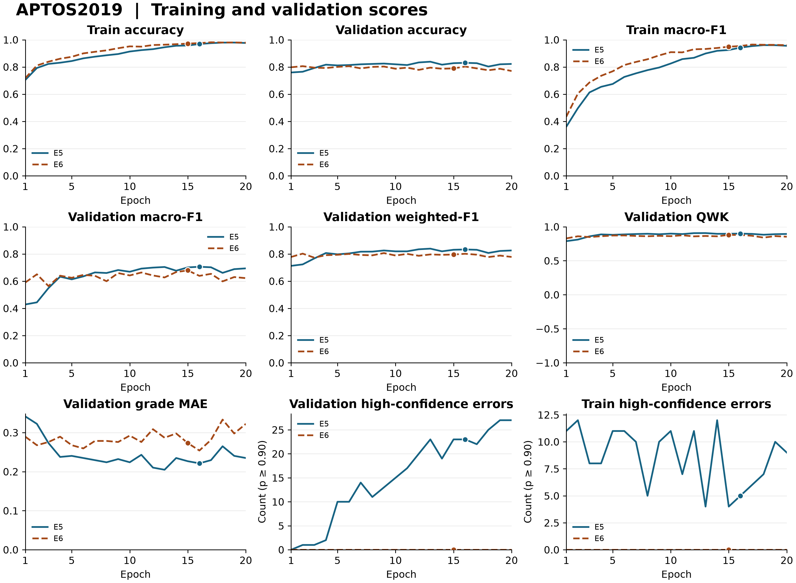

**Epoch scores.** Shared score scales by dataset. Solid E5 and dashed E6 traces use all 20 epochs. Circles mark each run’s selected epoch. The last-epoch validation macro-F1 values were 0.694 for E5 and 0.622 for E6, below their selected peaks. Training scores improved late in the runs, so training scores alone would favor a different stopping point. [SVG](figures/aptos2019_epoch_scores.svg).

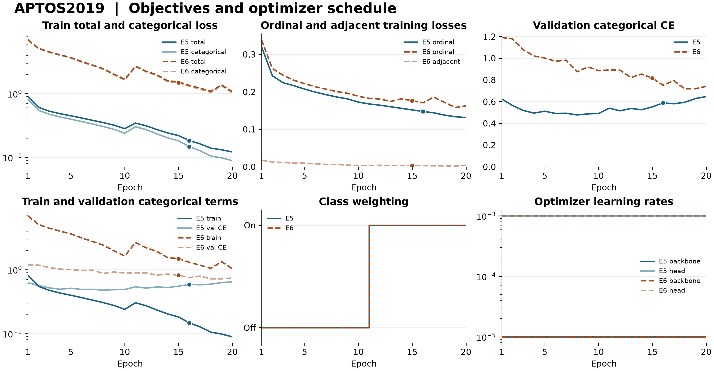

**Objective.** Validation CE uses raw categorical logits. Training losses differ by objective. The two train categorical panels and learning-rate panel use logarithmic axes. Lower panels show the recorded weight switch and both optimizer learning rates. Raw validation CE reached its minimum at epoch 8 for E5 and 18 for E6. These CE minima and the macro-F1 selection answer different questions. [SVG](figures/aptos2019_objective.svg).

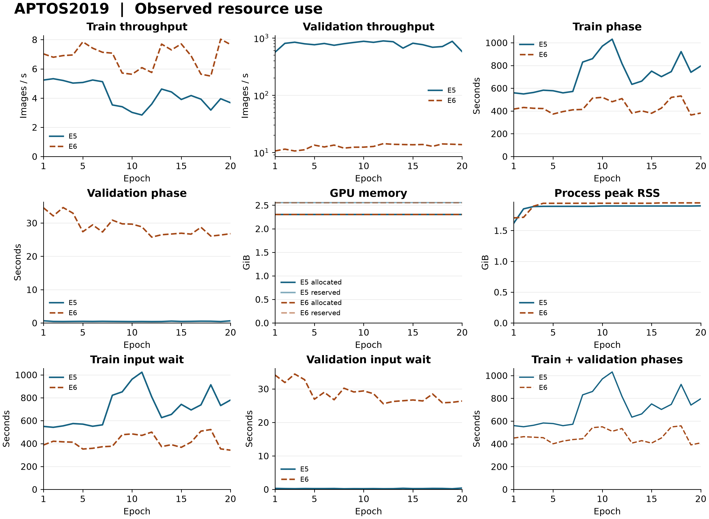

**Resources.** Durations, aggregate throughput, input wait and memory come from epoch records. Validation throughput uses a logarithmic axis to show both runs. Shared compute load, cache transport and process RSS scope limit hardware comparisons. Across 20 epochs, validation phases summed to 9.6 s (E5 cached tensors) and 578.0 s (E6 uncached processing). This is an observation about these completed runs. [SVG](figures/aptos2019_resources.svg).

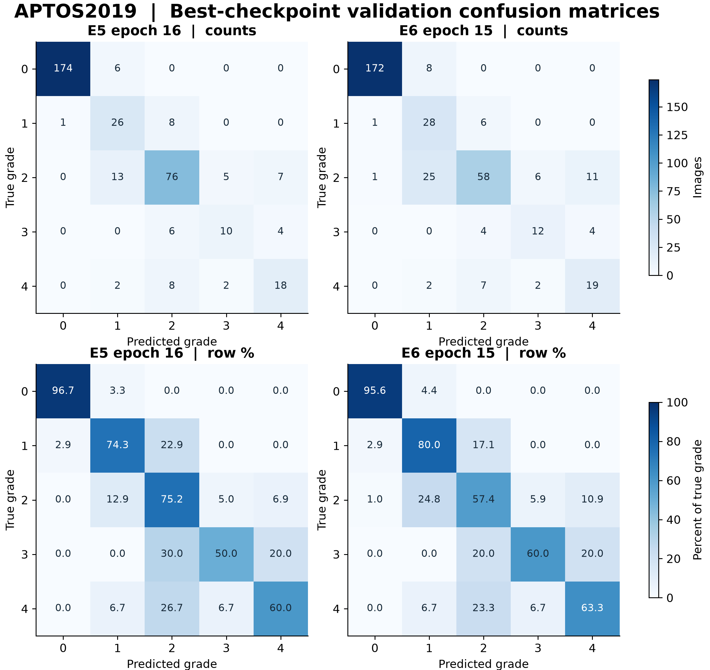

**Confusion.** Raw counts and percentages within each true grade at the selected validation checkpoint. A common count scale and a common percentage scale support within-dataset comparison. E5 correctly graded 304 images and E6 correctly graded 289. Raw grade 2→1 errors increased from 13 to 25. [SVG](figures/aptos2019_confusion.svg).

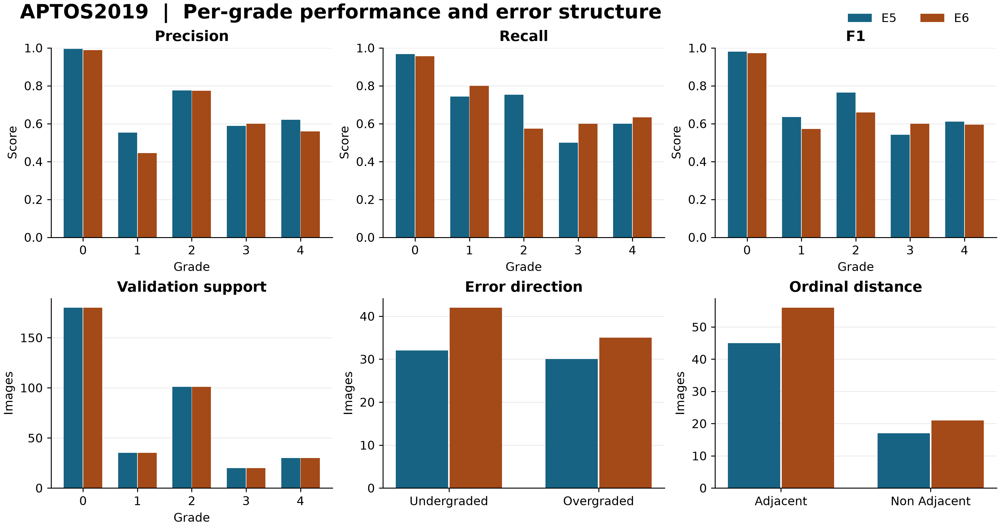

**Grade errors.** Precision, recall, F1 and support by grade. Direction and ordinal distance counts partition classification errors in two ways. Matrix-derived panels use the full frozen validation support. E6 grade 1 recall rose from 0.743 to 0.800 alongside more grade 1 false positives. Non-adjacent errors moved from 17 to 21. [SVG](figures/aptos2019_grade_errors.svg).

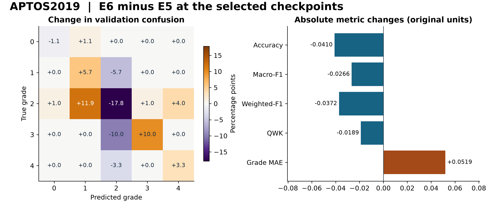

**Changes.** E6 minus E5 for each paired run on the same frozen validation split. Heatmap cells show changes to the row-normalized matrix in percentage points, not paired transitions for individual images. The grade 1 diagonal increased by 5.71 percentage points while macro-F1 changed by -0.02659. [SVG](figures/aptos2019_changes.svg).

### DDR figure suite

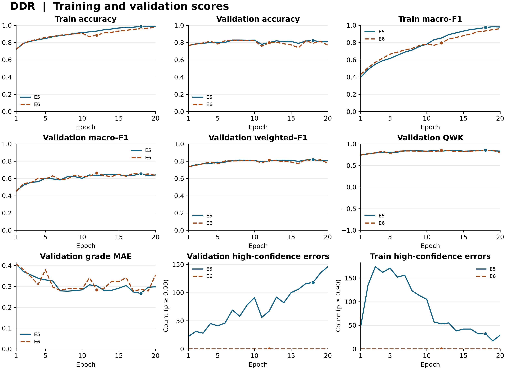

**Epoch scores.** Shared score scales by dataset. Solid E5 and dashed E6 traces use all 20 epochs. Circles mark each run’s selected epoch. The last-epoch validation macro-F1 values were 0.640 for E5 and 0.635 for E6, below their selected peaks. Training scores improved late in the runs, so training scores alone would favor a different stopping point. [SVG](figures/ddr_epoch_scores.svg).

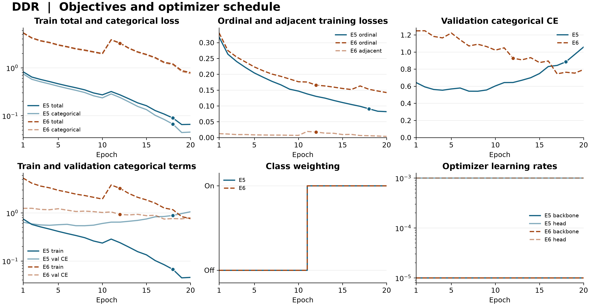

**Objective.** Validation CE uses raw categorical logits. Training losses differ by objective. The two train categorical panels and learning-rate panel use logarithmic axes. Lower panels show the recorded weight switch and both optimizer learning rates. Raw validation CE reached its minimum at epoch 8 for E5 and 17 for E6. These CE minima and the macro-F1 selection answer different questions. [SVG](figures/ddr_objective.svg).

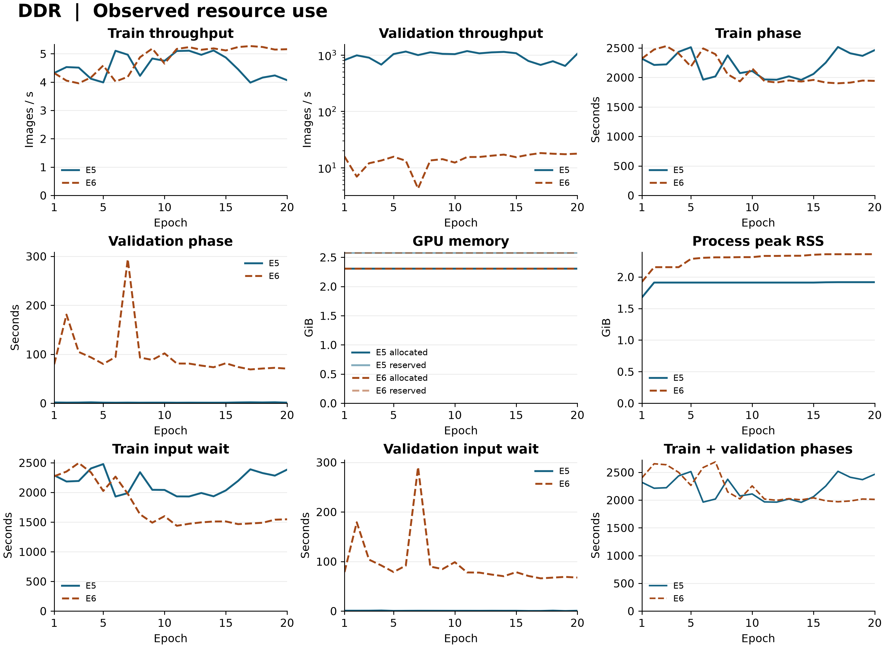

**Resources.** Durations, aggregate throughput, input wait and memory come from epoch records. Validation throughput uses a logarithmic axis to show both runs. Shared compute load, cache transport and process RSS scope limit hardware comparisons. Across 20 epochs, validation phases summed to 26.9 s (E5 cached tensors) and 1961.6 s (E6 uncached processing). This is an observation about these completed runs. [SVG](figures/ddr_resources.svg).

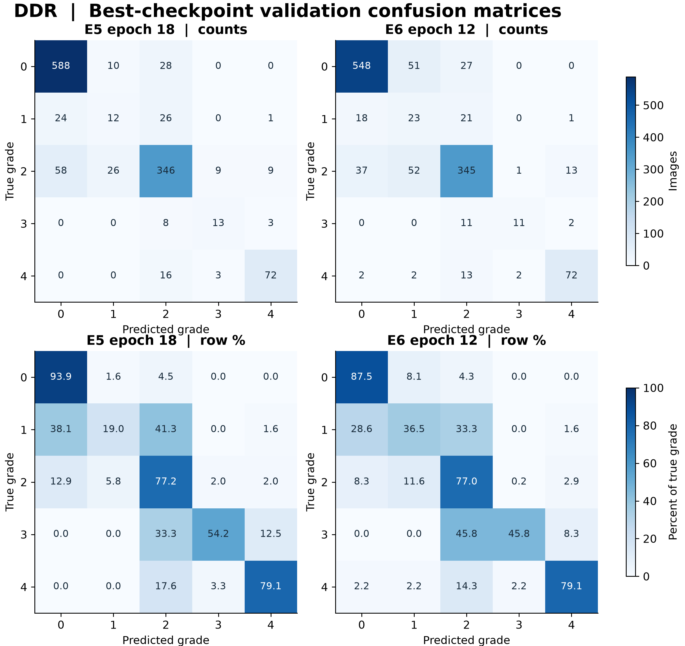

**Confusion.** Raw counts and percentages within each true grade at the selected validation checkpoint. A common count scale and a common percentage scale support within-dataset comparison. E5 correctly graded 1031 images and E6 correctly graded 999. Raw grade 2→1 errors increased from 26 to 52. [SVG](figures/ddr_confusion.svg).

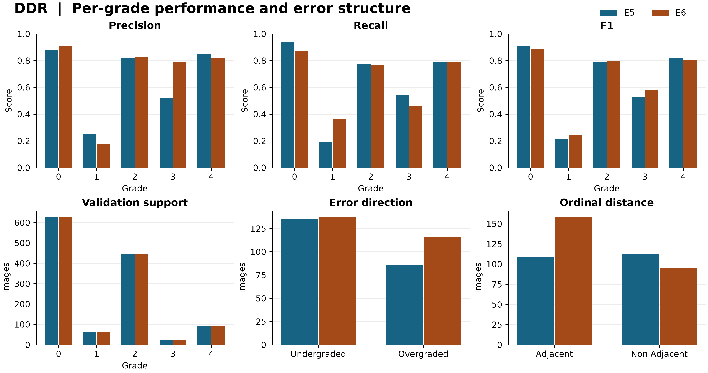

**Grade errors.** Precision, recall, F1 and support by grade. Direction and ordinal distance counts partition classification errors in two ways. Matrix-derived panels use the full frozen validation support. E6 grade 1 recall rose from 0.190 to 0.365 alongside more grade 1 false positives. Non-adjacent errors moved from 112 to 95. [SVG](figures/ddr_grade_errors.svg).

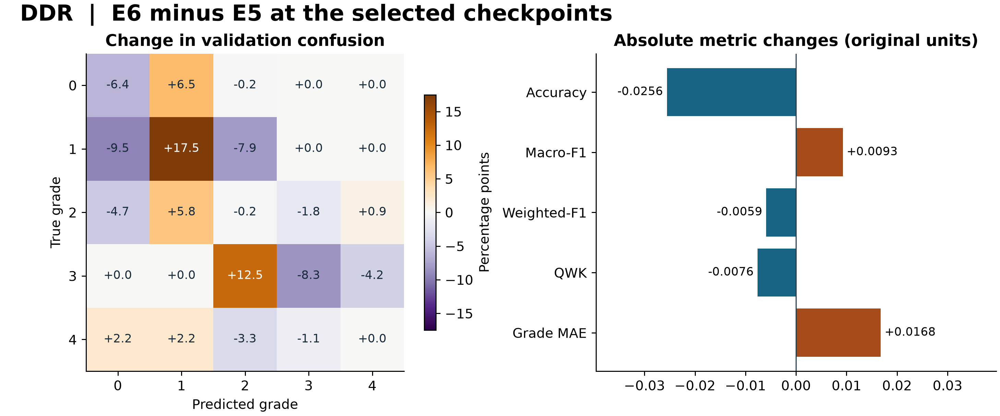

**Changes.** E6 minus E5 for each paired run on the same frozen validation split. Heatmap cells show changes to the row-normalized matrix in percentage points, not paired transitions for individual images. The grade 1 diagonal increased by 17.46 percentage points while macro-F1 changed by +0.00926. [SVG](figures/ddr_changes.svg).

## Audit and reproduction

| Status | Evidence |
| --- | --- |
| PASS | Four completed summaries, 80 ordered epochs, 1,800 CSV/JSON cell comparisons and 160 confusion matrices. Summary metrics and best-update flags agree with the recorded selection rule. |
| PASS | Frozen manifest fingerprints, ordered sample identities and five-grade class support agree within each dataset. |
| PASS | Eight supplied checkpoint SHA-256 values and byte sizes agree with the exported original file inventory. |
| PASS | All exported CSVs recover their original byte digests after CRLF restoration. All 62 run-level source SHA-256 checks match the recorded Git commits. |
| PASS | Existing E5 APTOS run, history CSV and summary bytes match the original export inventory hashes. |
| WARNING | The archive contains sanitized copies. Original and transferred file digests are recorded separately. The eight checkpoint binaries were verified on HPC according to the supplied audit. This review verifies receipts and sidecars. |
| WARNING | The export filter stripped per-grade MAE from JSON and omitted some fields such as the training image count. Original per-grade MAE values are preserved from CSV. Sample counts are separately derived from matrices. |
| WARNING | E6 epoch records omit cache counters. `run.json` is the recorded configuration for all four runs. |
| WARNING | Threshold counts require exported probabilities to audit independently. Those sample-level files are outside this package. |
| FAIL | No failures in the aggregate evidence checks. |

Source archive SHA-256: `d09ed35b456e79de12df32c3118c14b76b3f40a21b902d51d3b78d14c5e0608d`. The original and transferred member hashes and source-relative run identities are in each run’s evidence JSON. The source log is represented by its digest.

From the repository root, using Python with Matplotlib and Pillow, run the verification command below. `--write` generates the reports in a separate, empty output root. The plotting code uses aggregate JSON and CSV and does not import model code.

```bash
python docs/e5_e6_publication.py --export /path/to/e5_e6_publication_review.zip
python docs/e5_e6_publication.py --export /path/to/e5_e6_publication_review.zip --write --destination /path/to/empty-output
python -m unittest discover -s tests -p test_e5_e6_publication.py
```

## Validation and separate historical final test

The four training summaries record `final_test_status=NOT_ACCESSED` at training completion. A separately documented [E5 APTOS2019 final test](../results/APTOS2019/e5_integrated/README.md) retains its original provenance and scope. These figures and comparisons use validation results.
