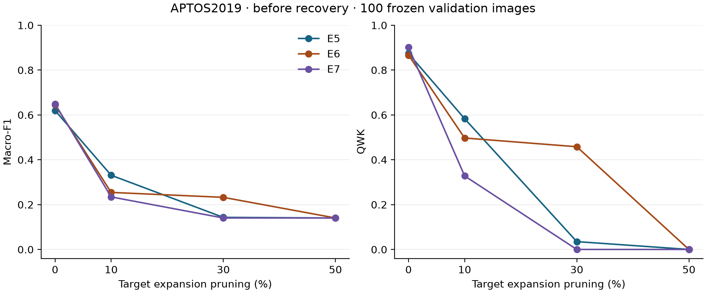
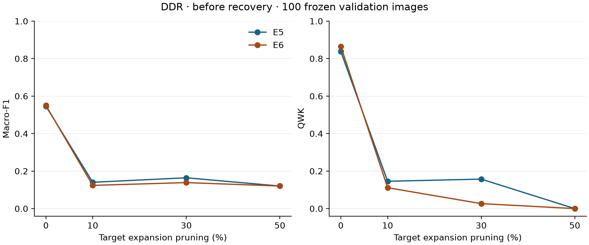
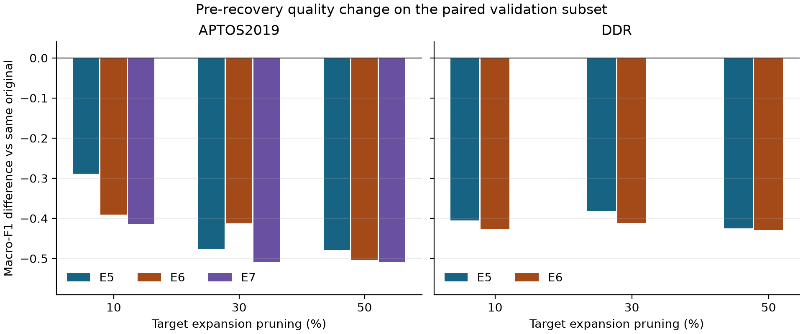
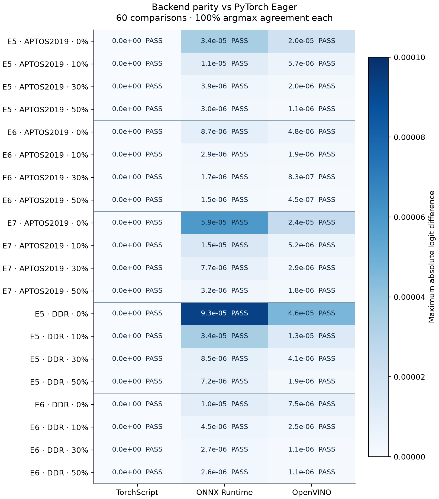

# Structured pruning pilot — before recovery

**Verified scope:** five checkpoint–dataset jobs, 20 model variants and 80 FP32 backend rows. Each job used 100 frozen **validation** images. This export supports a paired comparison of pre-recovery quality and numerical backend parity. Complexity, recovery, and latency have the evidence status recorded below.

## Protocol and provenance

The prepare campaign `pilot_100_v1` records the original, 10%, 30%, and 50% expansion-channel pruning targets. The [pruning implementation](../novelty_integrated/optimization/pruning.py) ranks the first pointwise linear layer's expansion channels by the L1 norm of the output weights per block. At target ratio (r), it removes `floor(r × expansion_width)` channels and their matching inputs to the second projection. Each arm starts from the same original checkpoint. Residual widths and the categorical head stay fixed. E5 and E6 use a single 224-pixel input. E7 shares one Hugging Face ConvNeXt V1 backbone across a 384-pixel global view and two 224-pixel local views and retains its fusion gate. The archived ConvNeXtV2 experiments are separate methodological references.

Selection ranked frozen validation rows by SHA-256 of the seed 42, image identifier and image SHA-256, then restored manifest order for the first 100 rows. Ordered validation positions and grade support agree across jobs on the same dataset. The grade counts (0–4) are **54 / 9 / 28 / 4 / 5** for APTOS2019 and **43 / 6 / 46 / 2 / 3** for DDR. E5 and E6 also agree on the ordered preprocessed tensor digest within each dataset. E7 has the same APTOS2019 sample and a distinct three-view tensor digest. Validation used batch size 1, FP32 and one CPU thread on a shared allocation. The warm-up and repeat settings in the preparation protocol were reserved for a possible timed stage. This validation did not run that stage.

| Job | Parent checkpoint epoch | Preparation source | Validation source | Per-job notebook |
| --- | ---: | --- | --- | --- |
| E5 APTOS2019 | 16 | `c101b1a` | `f406ddf` | [E5 APTOS2019](../notebooks/optimization/E5_APTOS2019.ipynb) |
| E6 APTOS2019 | 15 | `c101b1a` | `f406ddf` | [E6 APTOS2019](../notebooks/optimization/E6_APTOS2019.ipynb) |
| E7 APTOS2019 | 19 | `c101b1a` | `f406ddf` | [E7 APTOS2019](../notebooks/optimization/E7_APTOS2019.ipynb) |
| E5 DDR | 18 | `c101b1a` | `f406ddf` | [E5 DDR](../notebooks/optimization/E5_DDR.ipynb) |
| E6 DDR | 12 | `c101b1a` | `c7e61a8` | [E6 DDR](../notebooks/optimization/E6_DDR.ipynb) |

The local `PRUNING_PILOT_EVIDENCE.zip` is 55,642 bytes, SHA-256 `bb3f0968aa7130f59763049b00ab29e38ab2f7d715477263b7988c6766ecdb4b`. The archive passed CRC and an exact 15-member allowlist check. Each job supplied `protocol.json`, `validation/report.json`, and `validation/summary.csv`. The [published aggregate](../results/optimization/pilot_100_v1/validation_evidence.json) retains the public protocol and report fields, plus original byte counts and SHA-256 for all members. All 15 member files reconstruct byte for byte from the aggregate. The [generator](pruning_pilot_publication.py) verifies the five parent receipt digests, published checkpoint SHA-256 and epoch, processor and snapshot, frozen manifest, original member digests, and actual framework Git blobs. It checks the canonical protocol digest and reproduces each original CSV from the report. It also independently recalculates the aggregate scores, confusion-matrix counts, and per-grade metrics.

This is an audit of exported evidence. The original ZIP and its digest were available locally. An independently supplied source-side ZIP digest, checkpoint and backend binaries, raw logits, and validation images were outside the export. Checkpoint, manifest, prepared-model and input-tensor SHA-256 values document recorded lineage. The audit matches available receipts and does not attest independently to the server execution or reconstruct subset membership from the source images.

## Model complexity

The 20 canonical prepared-receipt digests are present. Parameter counts, actual parameter reductions, executed MACs, and actual MAC reductions are **unavailable** for the four arms of each job. The missing evidence is listed in [Completion status](#completion-status). The ratios below describe the expansion target. The published per-backend byte counts describe artifact files and can differ because of metadata and serialization.

| Jobs | Targets | Parameters | Actual parameter reduction | MACs per image | Actual MAC reduction |
| --- | --- | --- | --- | --- | --- |
| E5/E6/E7 APTOS2019 and E5/E6 DDR | 0%, 10%, 30%, 50% each | Unavailable | Unavailable | Unavailable | Unavailable |

The profiler convention counts executed Conv2d and Linear MACs, two FLOPs per MAC, with normalization, activation, pooling, other elementwise work and I/O excluded. E7 counts shared parameters once and counts MACs across all three views. A verified complexity figure or quality–complexity Pareto comparison requires the actual prepared receipts.

## Pre-recovery quality

Each row uses PyTorch Eager on the pilot subset. Differences are signed relative to the corresponding original checkpoint on the same images. Every delta (accuracy, Macro-F1, Weighted-F1, QWK and grade MAE) is retained at recorded precision in the [quality CSV](../results/optimization/pilot_100_v1/quality.csv). Macro-F1 gives each grade equal weight, Weighted-F1 weights by support, QWK measures chance-adjusted ordinal agreement and grade MAE gives mean absolute grade distance. The [aggregate JSON](../results/optimization/pilot_100_v1/validation_evidence.json) includes 5×5 confusion matrices with true grades as rows, predicted grades as columns, and per-grade precision, recall, F1 and support.

<!-- quality-table:start -->

| Job | Target | Accuracy | Macro-F1 | Weighted-F1 | QWK | Grade MAE | Δ Macro-F1 | Grade 1 recall | Grade 3 recall |
| --- | --- | --- | --- | --- | --- | --- | --- | --- | --- |
| E5_APTOS2019 | 0% | 0.8200 | 0.6195 | 0.8284 | 0.8734 | 0.2400 | +0.0000 | 0.5556 | 0.5000 |
| E5_APTOS2019 | 10% | 0.6700 | 0.3309 | 0.6550 | 0.5831 | 0.4800 | -0.2886 | 0.5556 | 0.0000 |
| E5_APTOS2019 | 30% | 0.5400 | 0.1430 | 0.3862 | 0.0349 | 0.9400 | -0.4765 | 0.0000 | 0.0000 |
| E5_APTOS2019 | 50% | 0.5400 | 0.1403 | 0.3787 | 0.0000 | 0.9700 | -0.4793 | 0.0000 | 0.0000 |
| E6_APTOS2019 | 0% | 0.7900 | 0.6448 | 0.8043 | 0.8664 | 0.2700 | +0.0000 | 0.7778 | 0.7500 |
| E6_APTOS2019 | 10% | 0.5900 | 0.2544 | 0.5440 | 0.4970 | 0.5800 | -0.3905 | 0.7778 | 0.0000 |
| E6_APTOS2019 | 30% | 0.5600 | 0.2324 | 0.5129 | 0.4581 | 0.6100 | -0.4124 | 0.7778 | 0.0000 |
| E6_APTOS2019 | 50% | 0.5400 | 0.1403 | 0.3787 | 0.0000 | 0.9700 | -0.5046 | 0.0000 | 0.0000 |
| E7_APTOS2019 | 0% | 0.8100 | 0.6490 | 0.8221 | 0.9016 | 0.2100 | +0.0000 | 0.5556 | 0.5000 |
| E7_APTOS2019 | 10% | 0.6200 | 0.2343 | 0.5286 | 0.3279 | 0.7100 | -0.4147 | 0.0000 | 0.0000 |
| E7_APTOS2019 | 30% | 0.5400 | 0.1403 | 0.3787 | 0.0000 | 0.9700 | -0.5087 | 0.0000 | 0.0000 |
| E7_APTOS2019 | 50% | 0.5400 | 0.1403 | 0.3787 | 0.0000 | 0.9700 | -0.5087 | 0.0000 | 0.0000 |
| E5_DDR | 0% | 0.8100 | 0.5457 | 0.8082 | 0.8375 | 0.2600 | +0.0000 | 0.3333 | 0.0000 |
| E5_DDR | 10% | 0.4500 | 0.1403 | 0.3040 | 0.1456 | 1.0600 | -0.4054 | 0.0000 | 0.0000 |
| E5_DDR | 30% | 0.4800 | 0.1642 | 0.3587 | 0.1571 | 1.0200 | -0.3815 | 0.0000 | 0.0000 |
| E5_DDR | 50% | 0.4300 | 0.1203 | 0.2586 | 0.0000 | 1.1600 | -0.4255 | 0.0000 | 0.0000 |
| E6_DDR | 0% | 0.8300 | 0.5498 | 0.8269 | 0.8648 | 0.2300 | +0.0000 | 0.3333 | 0.0000 |
| E6_DDR | 10% | 0.4300 | 0.1237 | 0.2660 | 0.1114 | 1.1000 | -0.4261 | 0.0000 | 0.0000 |
| E6_DDR | 30% | 0.4500 | 0.1387 | 0.3006 | 0.0264 | 1.1200 | -0.4112 | 0.0000 | 0.0000 |
| E6_DDR | 50% | 0.4300 | 0.1203 | 0.2586 | 0.0000 | 1.1600 | -0.4295 | 0.0000 | 0.0000 |

<!-- quality-table:end -->

All 15 pruned arms lost Macro-F1 relative to their paired original. At 50%, every job predicted grade 0 on all 100 images. This still yields 54% APTOS2019 accuracy and 43% DDR accuracy because those are the grade 0 proportions. QWK is zero in every 50% arm, and recall for grades 1–4 is zero. At 10%, E5 and E6 on APTOS2019 still correctly classified the same number of grade-1 cases as their original checkpoints, while their Macro-F1 fell. Every 10% arm had zero grade-3 recall, but both DDR originals also had zero grade-3 recall on the two available grade-3 cases. On DDR, the 30% arm had higher Macro-F1 than 10% for each model while both were far below the originals. These are descriptive, pointwise comparisons. The small support for grades 3 and 4 and prior use of the validation split for parent checkpoint selection limit generalization.







## Backend numerical parity

All 60 non-eager comparisons passed against their corresponding eager variant. The 20 eager self-reference rows are included for completeness. Each comparison reports zero changed argmax positions and 100% agreement on the 100 inputs. The framework uses `|backend − eager| ≤ 0.0001 + 0.0001 × |eager|` elementwise plus identical argmax. The largest exported absolute error is about `9.31025e-5` (E5 DDR ONNX Runtime); the aggregate maxima are themselves below the absolute tolerance. The stored confusion matrices coincide across backends for each variant. These are checks of predictions preserved by the export. They explain how an export can pass despite very weak underlying classification. The [complete parity CSV](../results/optimization/pilot_100_v1/numerical_parity.csv) gives device, precision, tolerance, status and logit error for each row.

<!-- parity-table:start -->

| Job | Backend vs eager | PASS | Min. argmax agreement | Max. absolute logit difference |
| --- | --- | --- | --- | --- |
| E5_APTOS2019 | TorchScript | 4/4 | 100% | 0 |
| E5_APTOS2019 | ONNX Runtime | 4/4 | 100% | 3.43323e-05 |
| E5_APTOS2019 | OpenVINO | 4/4 | 100% | 1.95503e-05 |
| E6_APTOS2019 | TorchScript | 4/4 | 100% | 0 |
| E6_APTOS2019 | ONNX Runtime | 4/4 | 100% | 8.70228e-06 |
| E6_APTOS2019 | OpenVINO | 4/4 | 100% | 4.76837e-06 |
| E7_APTOS2019 | TorchScript | 4/4 | 100% | 0 |
| E7_APTOS2019 | ONNX Runtime | 4/4 | 100% | 5.93662e-05 |
| E7_APTOS2019 | OpenVINO | 4/4 | 100% | 2.43187e-05 |
| E5_DDR | TorchScript | 4/4 | 100% | 0 |
| E5_DDR | ONNX Runtime | 4/4 | 100% | 9.31025e-05 |
| E5_DDR | OpenVINO | 4/4 | 100% | 4.62532e-05 |
| E6_DDR | TorchScript | 4/4 | 100% | 0 |
| E6_DDR | ONNX Runtime | 4/4 | 100% | 1.04904e-05 |
| E6_DDR | OpenVINO | 4/4 | 100% | 7.51019e-06 |

<!-- parity-table:end -->



## Completion status

| Evidence | Status | What is needed |
| --- | --- | --- |
| Pre-recovery quality and backend parity | **PASS, five jobs** | Complete for this 100-image pilot. Full validation and final test are distinct scopes. |
| Model complexity | `MISSING_PREPARED_PROFILES` | Export all 20 `<job>/prepared/{original,pruned_10,pruned_30,pruned_50}/prepared.json` files. Match each canonical digest to `prepared_receipt_sha256` and confirm the recorded topology and profile. Model binaries are unnecessary for publishing the recorded profiles. |
| E5 APTOS2019 recovery | `UNVERIFIED` | Export `E5_APTOS2019/recovered/recovery_protocol.json`, the four `recovered/<variant>/prepared.json` receipts with all three recovery epochs and final checkpoint digest, and `validation-recovered/{report.json,summary.csv}` from the same job root. |
| E7 APTOS2019 recovery | `UNVERIFIED` | Export `E7_APTOS2019/recovered/recovery_protocol.json`, the four recovery receipts and `validation-recovered/{report.json,summary.csv}` as above. Verify original multi-view input, gate, objective, optimizer, parent and three completed epochs. A process listing has no post-recovery quality evidence. |
| CPU latency and throughput | `NOT_MEASURED` | A separate isolated-CPU measurement receipt with machine, threads, model-only and end-to-end timings, warm-up, repetitions and artifact digests. The current export contains untimed shared-CPU validation. |

Recovery is a train-only, three-epoch study for each independent 0%, 10%, 30% and 50% arm. The 0% recovery arm controls for the additional optimization. Post-recovery gains require matched ordered validation samples, input tensors, score definitions, and parent-prepared hashes. E7 DDR was outside this campaign. No best recovery ratio or CPU speedup can be selected from this export.

## Reproduce figures and tables

The publication chain is **HPC ZIP → aggregate with original member digests → Python generator → PNG/SVG → per-job notebooks and this report → PPT/paper**. The plotting code works offline, does not run inference and requires a Git clone with the audited source revisions, the repository's Python dependencies, and Matplotlib. The reference rendering used Matplotlib 3.11.2. Generate into a separate destination to compare with the published copies.

```bash
python -m docs.pruning_pilot_publication --archive /path/to/PRUNING_PILOT_EVIDENCE.zip --write-tables /path/to/audit-tables
python -m docs.pruning_pilot_publication --figures /path/to/audit-figures
```

| Figure | Input | PNG | SVG | Notebook scope |
| --- | --- | --- | --- | --- |
| APTOS2019 quality | Eager Macro-F1 and QWK | [PNG](figures/pruning_pilot_aptos2019_quality.png) | [SVG](figures/pruning_pilot_aptos2019_quality.svg) | [APTOS2019 jobs](../notebooks/optimization/README.md) |
| DDR quality | Eager Macro-F1 and QWK | [PNG](figures/pruning_pilot_ddr_quality.png) | [SVG](figures/pruning_pilot_ddr_quality.svg) | [DDR jobs](../notebooks/optimization/README.md) |
| Paired change | Eager Δ Macro-F1 relative to own original | [PNG](figures/pruning_pilot_macro_f1_delta.png) | [SVG](figures/pruning_pilot_macro_f1_delta.svg) | This report, linked in all five notebooks |
| Backend parity | Non-eager maximum absolute logit error, PASS and argmax agreement | [PNG](figures/pruning_pilot_backend_parity.png) | [SVG](figures/pruning_pilot_backend_parity.svg) | This report and per-job parity tables |

Each PNG and SVG embeds its plotted input rows for figure verification. Use the figures in scientific presentations as an exploratory, validation-only, pre-recovery pilot. The dataset-specific sample size and stage should remain in captions. A quality–complexity–latency trade-off claim requires the missing profiles and timing evidence.
