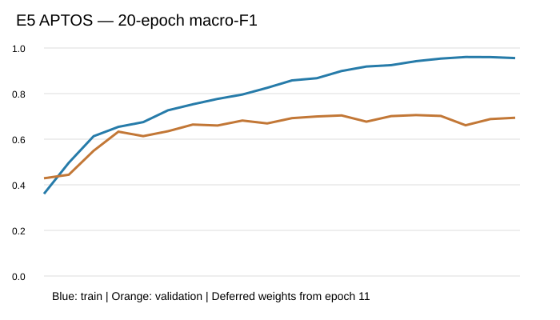
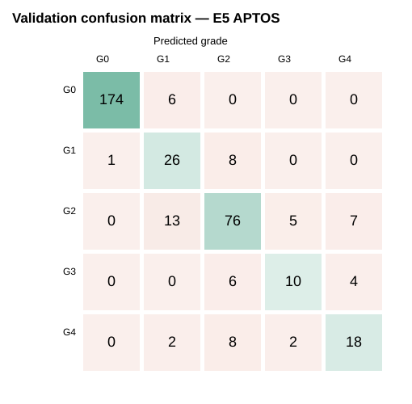

# APTOS2019 E5 Integrated — hasil terverifikasi

Model: official pretrained ConvNeXt-Tiny + categorical/ordinal heads, full fine-tuning, 20 epoch, best checkpoint **epoch 16**.

| Metrik | Validation | Final test |
| --- | ---: | ---: |
| Macro-F1 | 0.705791 | 0.640456 |
| Accuracy | 0.830601 | 0.825137 |
| QWK | 0.899241 | 0.891194 |
| Weighted-F1 | 0.833080 | 0.820085 |

Sumber: [run.json](run.json), [history.csv](history.csv), [summary.json](summary.json), [protocol.json](protocol.json), [test_summary.json](test_summary.json); [notebook analisis](../../../notebooks/03_ConvNeXt_E5_APTOS2019.ipynb).

Final test = **366** images; Grade 3 correct=4/19, F1=0.25. Ada 15 tambahan kemunculan SHA-256/group duplicate **di dalam** frozen test (tidak ada cross-split overlap train/validation–test menurut audit); test tidak diubah. Tidak ada klaim bahwa E5 mengungguli baseline tanpa ablation/matched protocol. Binary checkpoints tidak ada dalam Git.

`summary.json.final_test_status=NOT_ACCESSED` menyatakan status **saat training selesai**, sedangkan `test_summary.json` mencatat evaluasi final yang dijalankan kemudian.
